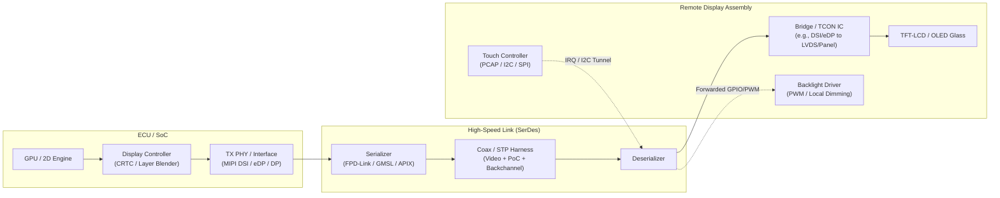
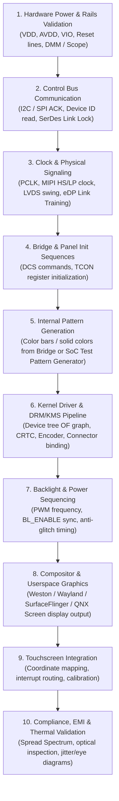

# Automotive Display Bring-Up Knowledge Base

A vendor-neutral, practical engineering guide and reference repository for bringing up display subsystems in automotive embedded platforms.

This repository covers display concepts, hardware interfaces, protocols, driver frameworks, and systematic debugging techniques across **Embedded Linux**, **Android (AOSP)**, **QNX Neutrino**, and various automotive **System-on-Chip (SoC)** architectures.

---

## 🧭 Overview & Architecture

Automotive display systems range from simple instrument cluster panels to multi-display distributed cockpits featuring Center Information Displays (CID), Passenger Displays, Head-Up Displays (HUD), and Rear Seat Entertainment (RSE).

Unlike consumer electronics, automotive displays typically involve long cable harnesses (up to 10–15 meters), serializer/deserializer (SerDes) links, bridge ICs, strict power-on sequencing, functional safety monitoring (ASIL requirements), and harsh EMI/EMC environments.



---

## 📚 Repository Structure

```text
automotive-display-bringup/
├── README.md                           # Repository overview and navigation
├── docs/                               # Core technical knowledge base
│   ├── acronyms.md                     # Automotive display glossary & acronyms
│   ├── display-pipeline.md             # End-to-end display pipeline (SoC to glass)
│   ├── drm-kms.md                      # Linux DRM/KMS framework & QNX Screen comparison
│   ├── panel-timing.md                 # Video timings, blanking intervals & calculations
│   ├── mipi-dsi.md                     # MIPI D-PHY/C-PHY, DSI protocol & packet formats
│   ├── lvds-edp.md                     # OpenLDI/LVDS mapping & Embedded DisplayPort (eDP)
│   ├── bridge-ic.md                    # Bridge ICs, protocol translation & driver binding
│   ├── serializer-deserializer.md      # FPD-Link, GMSL, PoC, backchannel & I2C aliasing
│   ├── device-tree.md                  # OF graph bindings, display controller, and bridge nodes
│   ├── power-reset-sequence.md         # Panel power rails, reset timing & sleep sequences
│   ├── backlight.md                    # PWM drivers, frequency selection, and local dimming
│   ├── touch.md                        # Automotive touch controller bring-up & backchannel IRQ
│   └── debug-checklist.md             # Systematic 10-step troubleshooting guide & triage tree
├── notes/                              # Real-world engineering case studies & templates
│   ├── bringup-cases/
│   │   └── template.md                 # Case study template for bring-up issues
│   └── log-analysis/
│       └── template.md                 # Template for dissecting kernel & graphics logs
├── assets/
│   └── diagrams/                       # Reusable diagrams, figures, and visual references
└── logs/
    └── samples/
        └── README.md                   # Guide and rules for sanitized log contributions
```

---

## 🚀 The Bring-Up Lifecycle

Bringing up an automotive display subsystem follows a rigorous hardware-to-software hierarchy:



---

## 🛠️ Multi-OS & Multi-Platform Scope

Display bring-up principles are universal across operating systems and silicon architectures:

| Concept / Layer | Embedded Linux | Android (AOSP) | QNX Neutrino |
| :--- | :--- | :--- | :--- |
| **Kernel / Display Driver** | Linux DRM/KMS (`drm_crtc`, `drm_bridge`, `drm_panel`) | Linux DRM/KMS or vendor-specific kernel driver (MSM/Kona, DPU, Exynos) | QNX Display Driver (`devg-*`, `libdisputil`, WFD driver) |
| **Hardware Abstraction** | DRM ioctl interface / Mesa GBM | Hardware Composer (HWC2 / AIDL Composer) | QNX Screen (`libscreen`), OpenKODE / EGL |
| **Compositor / Window Mgr** | Weston, Sway, wlroots, Mutter | SurfaceFlinger | QNX Screen Window Manager (`winmgr`) |
| **Display Configuration** | Device Tree (`.dts` / `.dtsi`) | Device Tree (`.dts`) + `display-id` vendor overlays | `graphics.conf`, driver configuration files |
| **CLI Diagnostic Tool** | `modetest`, `drm_info`, `kmstest` | `dumpsys SurfaceFlinger`, `dumpsys display` | `dispconf`, `screen-debug`, `slog2info` |

---

## ⚠️ Repository Guidelines & Sanitization

1. **Vendor Neutrality**: Explanations use standard industry terminology (MIPI, VESA, IEEE, OpenLDI, Linux Kernel DRM) rather than proprietary code names.
2. **Confidentiality & No NDA Violation**: Never commit confidential customer names, OEM program designations, internal bug tracker IDs, proprietary register maps, or raw internal logs.
3. **Reproducibility**: Use sanitized register dumps, generic DTS snippets, and synthetic test commands.
4. **Visual & Practical**: Every document prioritizes diagrams, tables, register calculations, and actionable step-by-step checklists over pure theory.
