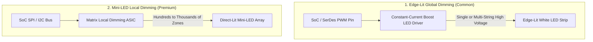

# Automotive Backlight & Dimming Systems

The backlight subsystem illuminates the liquid crystal display panel. In automotive environments, it must meet high brightness levels (up to 1,000–1,500 nits for daylight readability), wide dimming ratios (down to < 1 nit for night driving), and strict acoustic noise standards.

---

## 1. Backlight Architectures



---

## 2. PWM Frequency & Automotive Considerations

Modulating LED current using Pulse-Width Modulation (PWM) is standard, but the choice of frequency is critical:

| Frequency Range | Pros & Cons | Automotive Recommendation |
| :--- | :--- | :--- |
| **$< 1\,\text{kHz}$ (e.g., 200 Hz)** | Simple, high efficiency | **Forbidden**: Severe human-eye stroboscopic flicker and strong rolling-shutter camera interference. |
| **$1\,\text{kHz}$ to $18\,\text{kHz}$** | Moderate efficiency | **Avoid**: Inductors and ceramic capacitors vibrate mechanically (piezoelectric effect), causing audible high-pitched squealing / coil whine in the quiet cabin. |
| **$20\,\text{kHz}$ to $25\,\text{kHz}$** | Inaudible to humans, clean dimming | **Automotive Standard**: Well above human acoustic limit (20 kHz) while maintaining high boost converter efficiency. |
| **$> 50\,\text{kHz}$** | Completely inaudible, zero camera flicker | Requires specialized high-speed gate drivers; increased switching losses. |

### Perceptual Gamma Correction
The human eye perceives brightness logarithmically, not linearly. A linear increase in PWM duty cycle appears to jump rapidly at low brightness and saturate at high brightness.

$$\text{Perceived Brightness}\ (L^*) \approx \left(\frac{\text{Duty Cycle}}{100}\right)^\gamma \quad (\text{typically } \gamma = 2.2)$$

Automotive backlight drivers or HALs apply an exponential gamma lookup table (LUT) to map 0–255 software brightness levels into smooth perceptual steps.

---

## 3. Backlight Control & Power Sequencing Rules

* **Turn ON**: Assert Backlight Enable only **after** the video stream is active and stable for at least 10–20 frames (prevents blinding white flash).
* **Turn OFF**: Extinguish the Backlight **before** stopping the pixel clock or disabling display power rails.

```text
Sequence Rule:
1. Video Stream ON  ---> [ Wait 150-200ms ] ---> 2. Backlight ON
3. Backlight OFF    ---> [ Wait 50-100ms ]  ---> 4. Video Stream OFF
```

---

## 4. Thermal Derating & Ambient Light Sensor (ALS)

1. **Cabin Solar Load Throttling**:
   * Dashboards exposed to direct sunlight can reach internal temperatures exceeding **$85^\circ\text{C}$ to $105^\circ\text{C}$**.
   * Running LEDs at 100% current under these conditions degrades phosphor and shortens LED lifespan.
   * Thermal sensors on the display PCB trigger gradual current derating (e.g., reducing max brightness to 70% if PCB temp $> 80^\circ\text{C}$).
2. **Ambient Light Sensor (ALS)**:
   * Dynamically modulates backlight: 800–1000 nits during bright direct sunlight down to 2–5 nits inside dark tunnels or night driving to prevent driver glare.

---

## 5. Linux Subsystem & sysfs Verification

In Linux, the backlight driver exposes standard control attributes under `/sys/class/backlight/`:

```bash
# 1. Identify registered backlight devices
ls -la /sys/class/backlight/

# 2. Check maximum brightness level
cat /sys/class/backlight/backlight/max_brightness
# Output: 255

# 3. Read current brightness
cat /sys/class/backlight/backlight/brightness

# 4. Set brightness to 50%
echo 128 > /sys/class/backlight/backlight/brightness

# 5. Verify actual hardware brightness reported by driver
cat /sys/class/backlight/backlight/actual_brightness

# 6. Turn off backlight via sysfs (test anti-glitch behavior)
echo 0 > /sys/class/backlight/backlight/brightness
```

---

## 6. Backlight Bring-Up Troubleshooting

| Symptom | Root Cause | Fix / Verification |
| :--- | :--- | :--- |
| **High-pitched audible noise (whine)** | PWM frequency is in human audible range (1 kHz to 18 kHz) | Change DTS PWM period to 50,000 ns (20 kHz) or 40,000 ns (25 kHz). |
| **White flash during power-up** | Backlight enabled before valid pixel clock or DCS Display On | Add `msleep(200)` delay between video start and backlight enable in driver. |
| **Display remains black, but video is running** | LED boost converter fault, blown fuse, or BL_EN pin polarity inverted | Check `enable-gpios` polarity in DTS; probe boost output voltage with DMM. |
| **Banding on phone or DMS camera** | Camera exposure beat frequency with low PWM frequency | Increase PWM frequency above 20 kHz or synchronize PWM with camera frame sync. |
