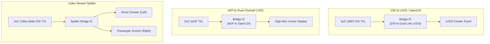
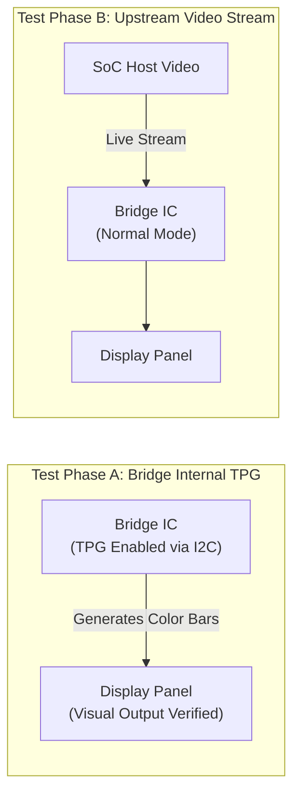

# Bridge ICs & Protocol Converters

Bridge Integrated Circuits (ICs) translate video protocols, scale resolutions, convert single-link signals to dual-link, or split streams across multiple displays in automotive systems.

---

## 1. Common Automotive Conversion Topologies



---

## 2. Hardware Interfaces & Control Architecture

Bridge ICs generally require three physical interfaces to function:

```text
Host SoC                                      Bridge IC                      Panel
+---------------+                             +---------------+              +-------+
| I2C / SPI     |============================>| I2C / SPI     |              |       |
| GPIO (RST/EN) |---------------------------->| RESET / EN    |              |       |
| Reference CLK |---------------------------->| REFCLK (XTAL) |              |       |
| Video TX      |============================>| Video RX      |=============>| Glass |
| Interrupt IRQ |<----------------------------| INT# (HPD/Err)|              |       |
+---------------+                             +---------------+              +-------+
```

1. **Control Interface (I2C or SPI)**: Used for reading chip ID, configuring internal PLL dividers, setting input/output color formats, and querying error counters.
2. **Clock Source**:
   * External onboard quartz crystal (typically 19.2 MHz, 24 MHz, 25 MHz, or 27 MHz).
   * Or a reference clock fed from an SoC PMIC/clock generator pin.
   * *Critical*: If the reference clock is missing or unstable, the internal PLL will fail to lock, preventing any output video.
3. **Hardware Control Pins**:
   * `RST_N` (Active-low reset): Must respect minimum hold time after power rails stabilize.
   * `ENABLE / PD_N` (Power-down control): Controls low-power standby modes.
   * `INT_N` (Interrupt): Reports loss of lock, FIFO errors, or downstream HPD state changes.

---

## 3. Linux DRM Bridge Driver Integration

In the Linux kernel, bridge drivers implement `drm_bridge_funcs` and register via `devm_drm_bridge_add()`:

```c
static const struct drm_bridge_funcs sample_bridge_funcs = {
    .attach       = sample_bridge_attach,
    .mode_valid   = sample_bridge_mode_valid,
    .pre_enable   = sample_bridge_pre_enable,  /* Powers on, loads I2C init tables */
    .enable       = sample_bridge_enable,      /* Enables video output / de-mutes */
    .disable      = sample_bridge_disable,     /* Mutes video output */
    .post_disable = sample_bridge_post_disable,/* Asserts reset, powers down */
};

static int sample_bridge_probe(struct i2c_client *client)
{
    struct sample_bridge *priv;
    /* 1. Parse device tree (regulators, reset GPIOs, clocks, OF graph endpoints) */
    /* 2. Verify chip ID over I2C */
    /* 3. Register bridge with DRM core */
    return devm_drm_bridge_add(&client->dev, &priv->bridge);
}
```

---

## 4. The Internal Test Pattern Generator (TPG) Technique

When bringing up a multi-chip pipeline (SoC $\rightarrow$ Bridge $\rightarrow$ Panel), diagnosing a black screen can be daunting. The **Test Pattern Generator (TPG)** is the ultimate isolation tool:



### Diagnostic Decision Rules
* **If Bridge TPG shows clear color bars on the panel**:
  * Downstream wiring, LVDS/eDP differential pairs, panel power sequencing, and backlight are **100% verified and functional**.
  * The root cause is strictly upstream: SoC D-PHY configuration, SoC pixel timings, or Bridge input format registers.
* **If Bridge TPG fails to display anything**:
  * The problem is downstream: Bridge PLL settings, panel power rails, backlight enable, or LVDS wiring. Upstream SoC debugging can be deferred.

---

## 5. Common Bridge Bring-Up Pitfalls

| Issue | Root Cause | Debugging Method |
| :--- | :--- | :--- |
| **I2C NACK on device address** | Incorrect I2C slave address strap pin (ADDR pin floating or tied to wrong rail) | Check hardware schematic strapping; use `i2cdetect -y -r <bus>` to scan the bus. |
| **Bridge PLL Unlocked** | Missing input reference clock or PCLK jitter exceeds threshold | Probe XTAL pins with an active oscilloscope probe; verify capacitive loading on crystal. |
| **Image split or scrambled** | Single-link to Dual-link pixel distributor misconfigured | Verify whether bridge expects Odd-First or Even-First pixel distribution. |
| **Display blinks every few seconds** | Watchdog timer inside bridge tripping due to lack of periodic I2C keepalive | Review bridge datasheet for auto-power-down or watchdog registers; disable in driver. |
