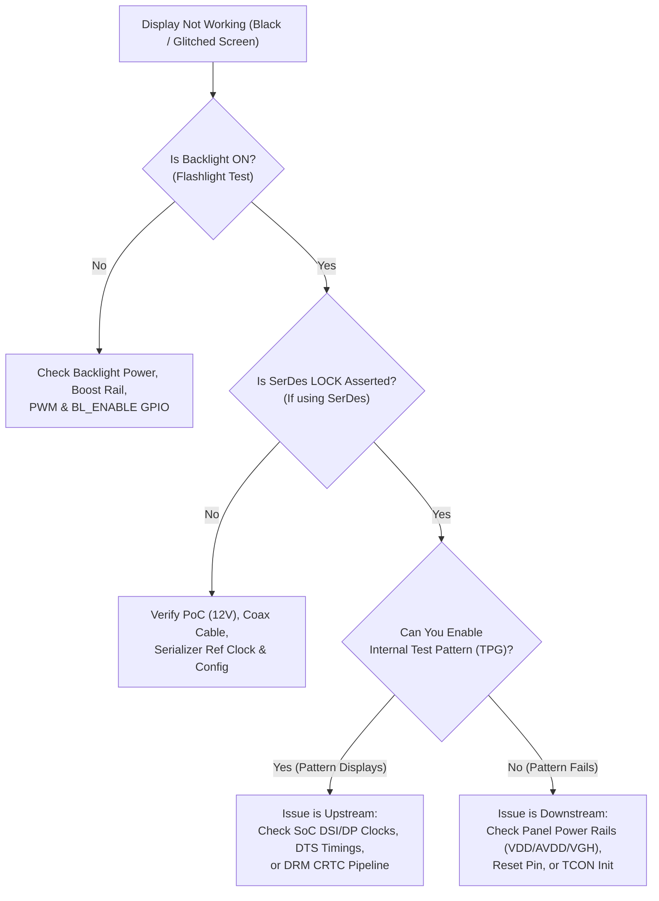

# Systematic Display Bring-Up Checklist & Triage Guide

A structured, 10-step methodology for isolating and resolving display failures during hardware bring-up on automotive embedded systems.

---

## 1. Fast Triage Decision Flowchart



---

## 2. The 10-Step Systematic Bring-Up Checklist

### Step 1: Power Rails & Voltage Measurement
* [ ] Verify **Logic Supply ($V_{DD}$)**: Measure with Digital Multimeter (DMM) at panel connector ($1.8\,\text{V} \pm 5\%$ or $3.3\,\text{V} \pm 5\%$).
* [ ] Verify **Analog Supply ($AV_{DD}$)**: Typically $8.0\,\text{V}$ to $12.0\,\text{V}$.
* [ ] Verify **Gate Drivers ($V_{GH}, V_{GL}$)**: $V_{GH} \approx +15\,\text{V}$ to $+25\,\text{V}$, $V_{GL} \approx -7\,\text{V}$ to $-12\,\text{V}$.
* [ ] Verify **PoC Voltage**: Measure $12.0\,\text{V}$ (or $9.0\,\text{V}$) on coaxial cable center pin under load.
* [ ] Verify **Power-On Sequence**: Capture $V_{DD} \rightarrow AV_{DD} \rightarrow V_{GH}/V_{GL}$ on a multi-channel oscilloscope to ensure correct sequential turn-on.

### Step 2: Reset Lines & Control Bus Communication
* [ ] Verify **Reset Pin**: Measure $RESET\_N$ with an oscilloscope. Ensure it transitions from Low to High **after** power rails stabilize (minimum hold time $\ge 10\,\text{ms}$).
* [ ] Scan I2C Bus:
  ```bash
  i2cdetect -y -r <i2c_bus_num>
  ```
  Ensure all bridge ICs, SerDes, and touch controllers acknowledge their addresses.
* [ ] Read Chip IDs: Query hardware revision registers to confirm I2C/SPI communication integrity.

### Step 3: SerDes Link & Lock Verification
* [ ] Verify **LOCK Pin**: Measure physical LOCK output pin on Deserializer (must be steady logic High).
* [ ] Check Link Status Registers: Verify forward channel lock, backchannel CRC error counters = 0.
* [ ] Run **BIST Pattern**: Enable SerDes built-in PRBS test mode to verify cable transmission quality before sending live video.

### Step 4: Physical Layer & Clock Signaling
* [ ] **MIPI DSI**:
  * Probe Clock Lane: Ensure differential clock toggles continuously in High-Speed mode.
  * Probe Data Lane 0: Verify transitions between LP-11 ($1.2\,\text{V}$) and HS burst ($200\,\text{mV}$).
* [ ] **OpenLDI / LVDS**:
  * Probe differential clock and data pairs with a differential probe.
  * Check differential peak-to-peak voltage ($300\,\text{mV}$ to $400\,\text{mV}$ across $100\,\Omega$ termination).
* [ ] **eDP**:
  * Verify HPD is asserted High ($3.3\,\text{V}$).
  * Verify AUX channel transactions succeed during DPCD probe.
  * Confirm Link Training passes (Clock Recovery and Channel Equalization locked).

### Step 5: Bridge & Panel Initialization Sequences
* [ ] Verify DCS commands sent: Ensure `0x11` (Sleep Out) is followed by at least **$120\,\text{ms}$ delay** before sending `0x29` (Display On).
* [ ] Check register readback: Read panel ID (`0xDA`, `0xDB`, `0xDC`) to confirm the driver IC is interpreting DCS commands.

### Step 6: Test Pattern Generator (TPG) Isolation
* [ ] Enable internal color bars or solid red/green/blue screens from the Bridge IC or SoC Display Controller.
* [ ] If the test pattern is crisp, skip hardware and PHY checks—the issue is purely upstream software/timing.

### Step 7: Video Timing Alignment
* [ ] Confirm **Pixel Clock ($PCLK$)**: Measure with oscilloscope or check PLL calculation against panel datasheet.
* [ ] Validate porch values ($HFP, HSA, HBP, VFP, VSA, VBP$) against min/typ/max specifications in the panel datasheet.
* [ ] Verify sync polarities (`DRM_MODE_FLAG_NHSYNC` vs `PHSYNC`, `NVSYNC` vs `PVSYNC`).

### Step 8: Linux DRM / KMS Stack Health
* [ ] Check DRM connector status:
  ```bash
  modetest -M <driver_name> -c
  ```
  Must report `status: connected`.
* [ ] Check atomic state and FIFO underruns:
  ```bash
  cat /sys/kernel/debug/dri/0/summary
  dmesg | grep -i -E "underrun|overflow|timeout|fence"
  ```
* [ ] Render test pattern directly through DRM:
  ```bash
  modetest -M <driver_name> -s <conn_id>:<mode_str>@<crtc_id>
  ```

### Step 9: Backlight & Anti-Glitch Timing
* [ ] Verify PWM frequency is above **$20\,\text{kHz}$** (avoids acoustic coil whine).
* [ ] Verify Backlight Enable is delayed by at least **$150\,\text{ms}$** after the first valid video frame to prevent white flashes.

### Step 10: Visual Artifact & Color Integrity
* [ ] Check for **Solarization / Banding**: If observed on LVDS, toggle `vesa-24` $\leftrightarrow$ `jeida-24`.
* [ ] Check for Red/Blue color inversion: Verify RGB vs BGR pixel format in DCS `0x36` or DRM plane format (`DRM_FORMAT_XRGB8888` vs `DRM_FORMAT_XBGR8888`).

---

## 3. Symptom-to-Root-Cause Quick Diagnostic Matrix

| Visual Symptom | Root Cause Candidates | Top Inspection Step |
| :--- | :--- | :--- |
| **Completely black screen, no light** | Backlight unpowered, BL_EN low, or boost converter fault | Perform "flashlight test": shine phone light closely at glass to see if faint image is visible. |
| **Backlight on, screen uniformly black** | TCON in sleep mode, PCLK out of lock range, or SerDes unlocked | Measure SerDes LOCK pin; check bridge IC TPG; verify DCS Sleep-Out sent. |
| **Blinding white screen** | Panel logic powered off while backlight on, or source drivers floating | Check panel $V_{DD}$ rail; inspect power-on sequence delays. |
| **Severe solarization (metallic skin tones)** | VESA vs. JEIDA LVDS bit mapping mismatch | Change `data-mapping` in DTS between `vesa-24` and `jeida-24`. |
| **Diagonal lines / rolling image** | VSYNC frequency mismatch or inverted sync polarities | Toggle sync active-high / active-low flags in DTS. |
| **Flickering pixels / sparkling snow** | High-speed signal integrity degradation or PCLK sampling clock edge | Change `pixelclk-active` edge; check cable shielding and eye diagram. |
| **Image shifted left or right** | Incorrect $HBP$ (Back Porch) or $HFP$ (Front Porch) | Adjust horizontal porch values while keeping total $HTOT$ constant. |
| **Red and blue colors swapped** | BGR vs RGB pixel format misconfiguration | Verify DRM plane format and panel DCS memory access command `0x36`. |
