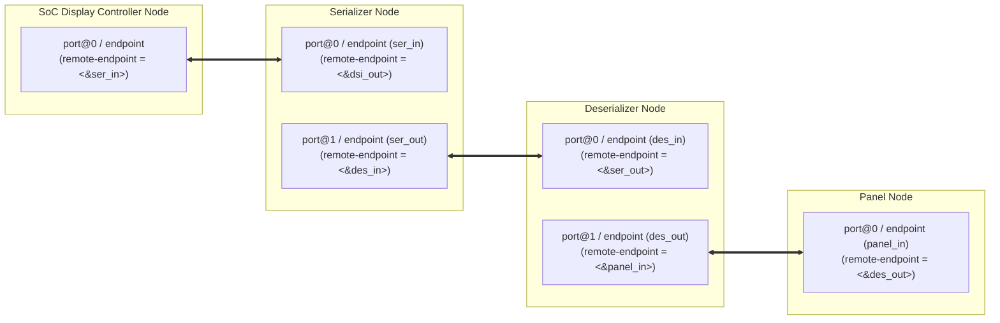

# Device Tree (DTS) Architecture for Display Subsystems

In embedded Linux and Android, the Device Tree describes the hardware topology of the display pipeline, including regulators, reset GPIOs, control buses, and video stream links using Open Firmware (OF) graph bindings.

---

## 1. The OF Graph Concept (`ports` & `endpoints`)

Linux DRM constructs its display pipeline by parsing `port` and `endpoint` nodes. Each endpoint links to its partner via a `remote-endpoint` phandle:



---

## 2. Complete Vendor-Neutral Device Tree Example

Below is a complete DTS snippet modeling an SoC connected to a SerDes serializer, remote deserializer, and automotive LVDS panel:

```dts
/dts-v1/;
/plugin/;

/ {
    /* Backlight Controller */
    backlight: backlight {
        compatible = "pwm-backlight";
        pwms = <&pwm1 0 50000 0>;       /* 20 kHz (period = 50,000 ns) */
        brightness-levels = <0 16 32 64 128 192 255>;
        default-brightness-level = <5>;
        enable-gpios = <&gpio2 14 0>;    /* Active High BL_ENABLE */
        power-supply = <&reg_12v_display>;
    };

    /* Remote Display Panel */
    panel: panel-lvds {
        compatible = "panel-lvds";
        backlight = <&backlight>;
        power-supply = <&reg_display_3v3>;
        reset-gpios = <&gpio3 21 1>;     /* Active Low Reset */

        width-mm = <293>;
        height-mm = <110>;
        data-mapping = "jeida-24";       /* JEIDA 24-bit LVDS mapping */

        panel-timing {
            clock-frequency = <74250000>;
            hactive         = <1920>;
            vactive         = <720>;
            hfront-porch    = <60>;
            hsync-len       = <20>;
            hback-porch     = <100>;
            vfront-porch    = <10>;
            vsync-len       = <5>;
            vback-porch     = <15>;
            hsync-active    = <0>;
            vsync-active    = <0>;
            de-active       = <1>;
            pixelclk-active = <1>;
        };

        port {
            panel_in: endpoint {
                remote-endpoint = <&des_out>;
            };
        };
    };
};

/* SoC I2C Bus hosting the Serializer */
&i2c1 {
    status = "okay";
    clock-frequency = <400000>;

    serializer@3c {
        compatible = "vendor,automotive-serializer";
        reg = <0x3c>;
        power-supply = <&reg_1v8_ser>;
        reset-gpios = <&gpio1 5 1>;

        ports {
            #address-cells = <1>;
            #size-cells = <0>;

            /* Input from SoC DSI Host */
            port@0 {
                reg = <0>;
                ser_in: endpoint {
                    remote-endpoint = <&dsi_out>;
                };
            };

            /* Forward Link to Remote Deserializer */
            port@1 {
                reg = <1>;
                ser_out: endpoint {
                    remote-endpoint = <&des_in>;
                };
            };
        };

        /* Sub-node defining remote I2C bus over SerDes backchannel */
        i2c-bus {
            #address-cells = <1>;
            #size-cells = <0>;

            deserializer@2c {
                compatible = "vendor,automotive-deserializer";
                reg = <0x2c>;

                ports {
                    #address-cells = <1>;
                    #size-cells = <0>;

                    port@0 {
                        reg = <0>;
                        des_in: endpoint {
                            remote-endpoint = <&ser_out>;
                        };
                    };

                    port@1 {
                        reg = <1>;
                        des_out: endpoint {
                            remote-endpoint = <&panel_in>;
                        };
                    };
                };
            };
        };
    };
};

/* SoC DSI Display Controller Output Port */
&dsi_host {
    status = "okay";

    ports {
        port@1 {
            reg = <1>;
            dsi_out: endpoint {
                remote-endpoint = <&ser_in>;
            };
        };
    };
};
```

---

## 3. Runtime Device Tree Inspection & Debugging

When a driver fails to probe, inspecting the live device tree in userspace confirms whether aliases, phandles, and pinmux configurations were applied correctly:

```bash
# 1. Decompile the active kernel device tree back into readable DTS
dtc -I fs -O dts /proc/device-tree > /tmp/live_running_kernel.dts

# 2. Search for the display connector or panel in the live tree
grep -A 20 "panel-lvds" /tmp/live_running_kernel.dts

# 3. Check GPIO allocation to verify pins are claimed by the display driver
cat /sys/kernel/debug/gpio

# 4. Verify regulator voltages and enable state
cat /sys/kernel/debug/regulator/regulator_summary

# 5. Check PWM channel configuration
cat /sys/kernel/debug/pwm
```
