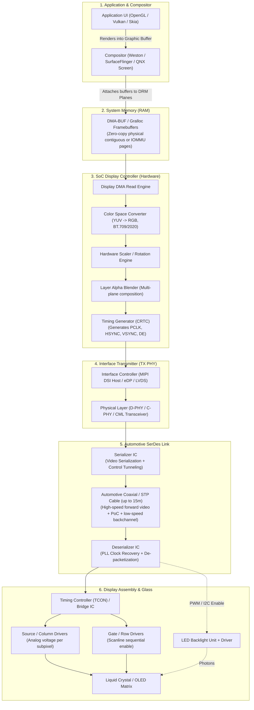
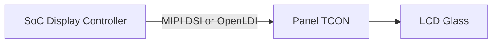
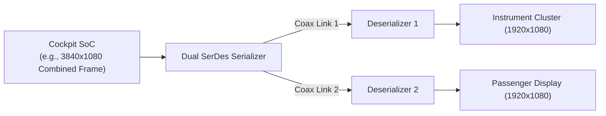

# Automotive Display Pipeline: SoC Memory to Glass

This document details the end-to-end data and signal pipeline that transforms raw pixel buffers in SoC system RAM into photons emitted by the automotive display panel.

---

## 1. End-to-End Pipeline Overview



---

## 2. Detailed Pipeline Stages

### Stage 1 & 2: Userspace & Buffer Management
* **Compositor**: Blends multiple application windows (Instrument Cluster cluster UI, Navigation, HVAC controls).
* **Buffer Allocation**: Uses Linux `dma-buf` / GEM dumb buffers or Android `gralloc`.
* **Zero-Copy**: The SoC display controller reads directly from graphic memory via display DMA channels without CPU copying.
* **Synchronization**: Explicit sync fences (sync files / DRM in-fences & out-fences) prevent tearing and ensure rendering is complete before scanout.

### Stage 3: SoC Display Processing Engine (CRTC)
* **DMA Read**: Fetches RGB or YUV planes from RAM using dedicated display memory buses (AXI/NoC).
* **Pixel Processing**:
  * Format unpacking (e.g., ARGB8888, NV12).
  * Color space conversion (YUV to RGB matrix).
  * Scaling, crop, and hardware rotation (90°/180°/270°).
  * Multi-layer blending (overlaying warning telltales on top of 3D cluster graphics).
* **Timing Generator**: Crafts the pixel raster beam using configured porch and sync parameters ($HFP, HSA, HBP, VFP, VSA, VBP$) driven by a dedicated Display PLL.

### Stage 4: SoC Interface Transmitter
* Converts pixel stream into packetized or serialized format:
  * **MIPI DSI**: Packets serialized into HS (High Speed) differential lanes (Clock + 1 to 4 Data lanes).
  * **eDP / DP**: 8b/10b or 128b/132b encoded main link symbols over high-speed AC-coupled differential pairs.
  * **LVDS / OpenLDI**: 7-to-1 serialization per differential channel (3 to 8 data pairs + 1 clock pair).

### Stage 5: Automotive SerDes Link
* **Serializer**: Situated on the central ECU mainboard adjacent to the SoC. Multiplexes:
  * High-speed video stream (forward channel: 3 to 12 Gbps).
  * Reverse control channel (backchannel: 10 to 50 Mbps) for I2C, SPI, GPIOs, and interrupts.
* **Cable**: Automotive grade single coaxial (50 $\Omega$) or Shielded Twisted Pair (STP, 100 $\Omega$).
* **Power-over-Coax (PoC)**: DC voltage (typically 12V or 9V) is combined onto the coax center conductor through an inductor filter network to power the remote display module.
* **Deserializer**: Situated on the display module PCB. Recovers the bit clock using an integrated PLL, reconstructs the original video interface, and breaks out the control buses.

### Stage 6: Remote Display Module & Glass
* **TCON (Timing Controller)**: Converts received standard digital video (LVDS, eDP, or MIPI) into specialized panel signals:
  * **mini-LVDS / Point-to-Point Differential Signaling (P2P)** to Source Drivers.
  * Control pulses (`STV`, `CPV`, `OE`) to Gate Drivers.
* **Source & Gate Drivers**: Gate drivers activate one row at a time. Source drivers apply analog grayscale voltages to each column capacitor.
* **Liquid Crystal / Light Generation**: Transmissivity of each subpixel modulates white light from the LED backlight (or self-emitting OLED elements).

---

## 3. Typical Automotive Topologies

### Topology A: Direct Connection (Local Bench / Cluster)
Used when the display is physically co-located within the ECU housing (e.g., integrated cluster unit).



### Topology B: Remote Single Display via SerDes (CID / HUD / Cluster)
Standard distributed cockpit architecture separating central compute from in-cabin displays.

```mermaid
flowchart LR
    SoC["Cockpit SoC"] -->|MIPI DSI / eDP| SER["Serializer"]
    SER -->|Long Coaxial Cable (PoC)| DES["Deserializer"]
    DES -->|OpenLDI / eDP| TCON["Panel TCON"]
    DES -->|I2C / GPIO| TOUCH["Touch Controller"]
```

### Topology C: Splitter / Dual Display Topology
Driving two displays (e.g., Driver Cluster + Passenger Screen) from a single high-bandwidth display interface or SerDes link.



---

## 4. Automotive Functional Safety & Latency Requirements

1. **Early Display / Fast Reverse Camera (RVC)**:
   * Legal requirement: Rear-view camera video must appear on screen within **2.0 seconds** of vehicle ignition/reverse gear engagement.
   * Architecture approaches: Hardware bypass video path, early microkernel/RTOS display handoff to high-level OS, or early-boot Linux driver.
2. **Freeze Detection & Tell-tale Monitoring**:
   * Instrument clusters must detect frozen frames or corrupted warning icons (ISO 26262 ASIL-B / ASIL-D).
   * Hardware CRC units calculate frame checksums in the display controller or deserializer and compare against expected reference values.
3. **Display Link Integrity**:
   * Continuous monitoring of SerDes `LOCK`, eye opening metrics, and cable degradation alarms.
