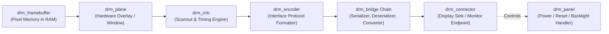
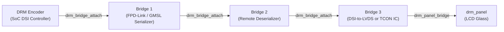
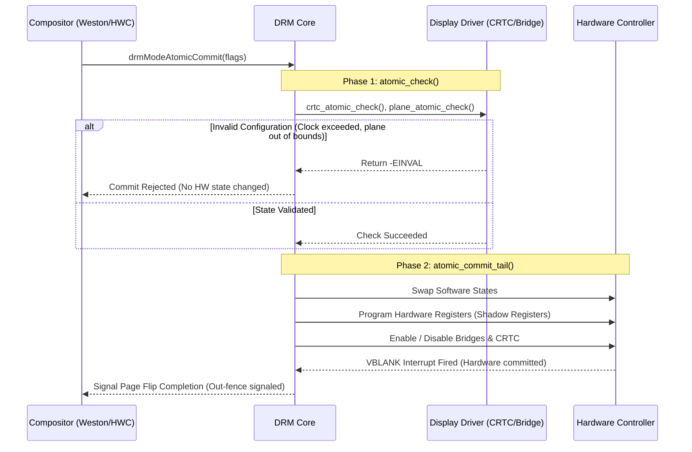

# Linux DRM/KMS Framework & Automotive Graphics

The Direct Rendering Manager (DRM) and Kernel Mode Setting (KMS) subsystem is the standard display driver architecture in Linux and Android. This document explains the KMS object model, atomic modesetting, bridge chaining, and compares it with QNX Screen.

---

## 1. DRM/KMS Object Model

KMS models display hardware as a directed pipeline of specialized objects:



### KMS Object Definitions

| Object | Kernel Struct | Hardware Analogy | Role in Automotive |
| :--- | :--- | :--- | :--- |
| **Framebuffer** | `struct drm_framebuffer` | Memory buffer in RAM | Backed by `dma-buf` / GEM allocations, containing rendered pixels. |
| **Plane** | `struct drm_plane` | Hardware scanout layer | Layers (Primary UI, Video overlay, Tell-tale alert overlay) composited by display hardware. |
| **CRTC** | `struct drm_crtc` | Display Timing Generator | Reads plane buffers, generates pixel timing ($PCLK, HSYNC, VSYNC$), controls gamma LUTs. |
| **Encoder** | `struct drm_encoder` | SoC Video TX Formatter | Translates parallel pixel streams from CRTC into digital interface streams (DSI, DP, parallel). |
| **Bridge** | `struct drm_bridge` | Off-SoC Conversion IC | Chained auxiliary ICs: Serializers, Deserializers, DSI-to-LVDS bridges, redrivers. |
| **Connector** | `struct drm_connector` | Physical connection port | Represents the display sink, provides EDID, connection status (Connected/Disconnected). |
| **Panel** | `struct drm_panel` | Physical LCD/OLED glass | Manages panel power supplies, reset GPIOs, sleep-out delays, and hardcoded timings. |

---

## 2. Automotive DRM Bridge Chaining

In modern automotive cockpits, video rarely goes directly from SoC to panel. Instead, it passes through multiple bridge chips. Linux DRM handles this via **Bridge Chaining**:



### Bridge Callbacks Execution Order

When changing modes or powering on, DRM calls bridge operations in strict topological sequence:

* **Enable Sequence** (Forward traversal: SoC $\rightarrow$ Panel):
  1. `bridge->pre_enable()` (SoC to Sink: prepares hardware while video clock is off or starting).
  2. `encoder->enable()` (SoC starts clock and video stream).
  3. `bridge->enable()` (Reverse traversal: Sink to SoC: enables display output and backlight).
* **Disable Sequence** (Reverse order: shuts down backlight first to prevent visible flash artifacts).

---

## 3. Atomic Modesetting Pipeline

Modern DRM uses **Atomic Modesetting**, ensuring updates across planes, CRTCs, and connectors are validated and applied simultaneously within a single frame interval without tearing:



---

## 4. Linux DRM vs. QNX Screen Comparison

| Concept | Linux DRM/KMS | QNX Neutrino Screen |
| :--- | :--- | :--- |
| **Driver Framework** | Kernel-space `drm_driver`, `drm_crtc_helper_funcs` | User-space / Microkernel display driver (`libdisputil`, `devg-*`) |
| **Standard Spec** | Linux Kernel upstream DRM API | Khronos OpenWF Display (WFD) and QNX proprietary Screen APIs |
| **Overlay / Planes** | `drm_plane` (Primary, Overlay, Cursor) | Screen Pipelines and Windows (`SCREEN_PROPERTY_PIPELINE`) |
| **Buffer Allocation** | `dma-buf`, GEM, ion | QNX shared memory (`mmap`, Screen buffers) |
| **Configuration** | Device Tree (`.dts`), kernel command line | `/etc/system/config/graphics.conf` |
| **Test Command** | `modetest`, `kmstest` | `dispconf`, `screen-debug`, `screenshot` |

---

## 5. Essential DRM/KMS Debugging Commands

### 1. Probing the Display Pipeline with `modetest`
`modetest` is the single most valuable tool for diagnosing DRM drivers in Linux.

```bash
# List all DRM connectors, encoders, CRTCs, and planes
modetest -M <driver_name>

# Example: Display color bars on connector 32 using mode 1920x1080@60 on CRTC 28
modetest -M <driver_name> -s 32:1920x1080-60@28

# Display color bar pattern on hardware overlay plane 30
modetest -M <driver_name> -s 32:1920x1080-60@28 -P 30:1920x1080+0+0@XR24
```

### 2. Dumping Pipeline Summary from DebugFS
```bash
# View active CRTCs, planes, connectors, and power state
cat /sys/kernel/debug/dri/0/summary

# View the full atomic state dump (plane coordinates, buffer addresses, fences)
cat /sys/kernel/debug/dri/0/state
```

### 3. Enabling Kernel DRM Debug Logging
```bash
# Bitmask breakdown:
# 0x01 = CORE, 0x02 = DRIVER, 0x04 = KMS, 0x08 = PRIME, 0x10 = ATOMIC, 0x20 = VBL
# Enable atomic and KMS logging:
echo 0x16 > /sys/module/drm/parameters/debug

# Enable verbose logging (all categories):
echo 0x1ff > /sys/module/drm/parameters/debug

# View live kernel ring buffer for display messages:
dmesg -w | grep -E "drm|kms|atomic|plane|crtc"
```
