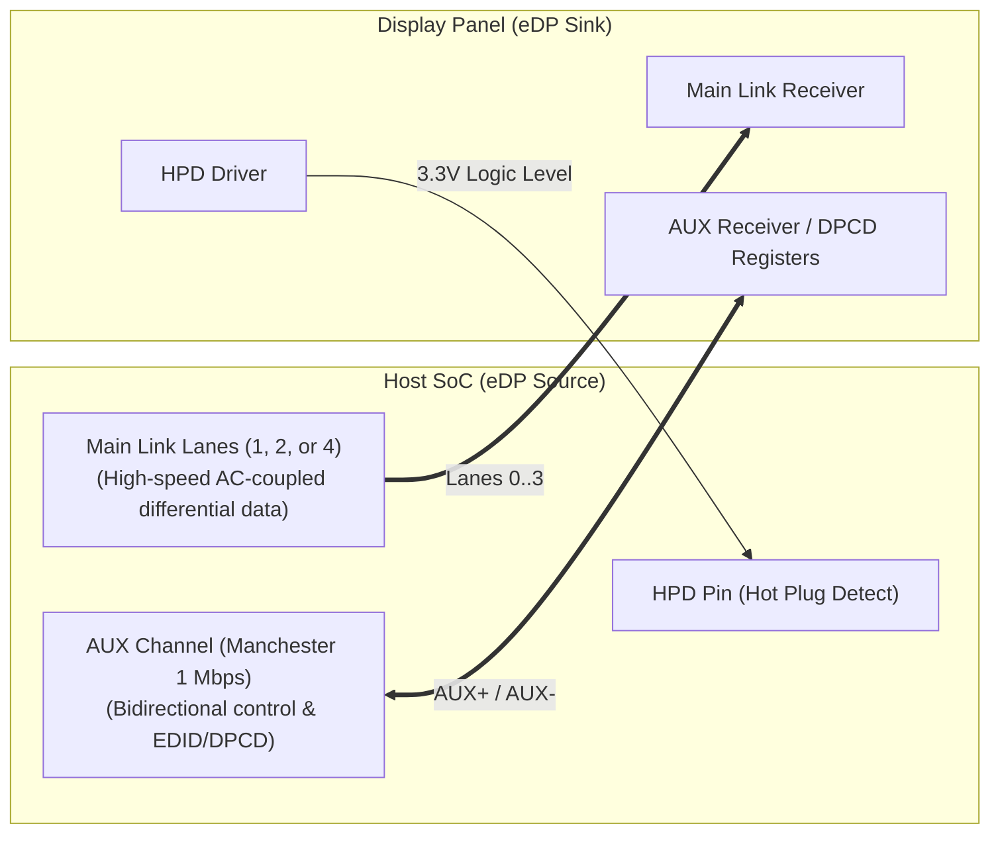
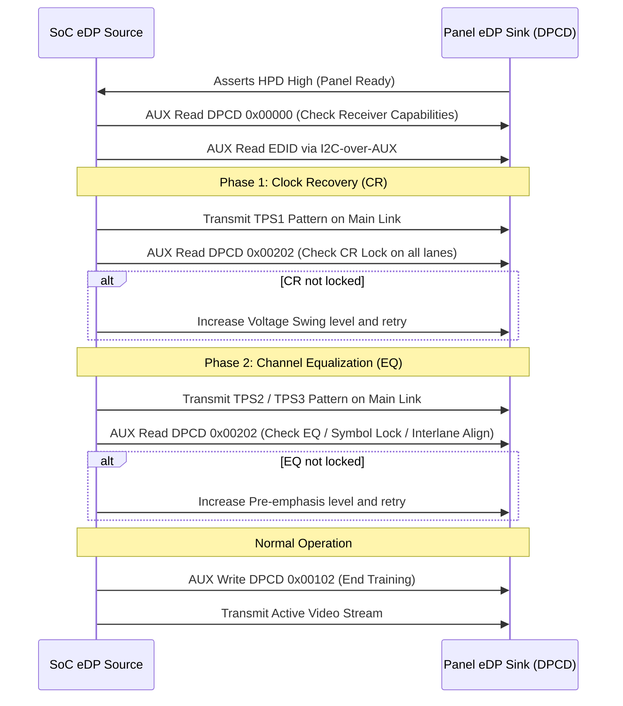

# OpenLDI/LVDS & Embedded DisplayPort (eDP)

This guide covers the electrical characteristics, data mapping formats, protocol handshakes, and debugging methods for **OpenLDI/LVDS** and **Embedded DisplayPort (eDP)** interfaces in automotive display systems.

---

## 1. OpenLDI / LVDS Interface

OpenLDI is an LVDS-based standard using a 7:1 serialization ratio: 7 bits of video data are serialized onto each differential pair during a single pixel clock ($PCLK$) cycle.

```text
Single-Link LVDS (4 Data + 1 Clock Pair):
TX (SoC / SerDes)                                Panel / TCON
+---------------+       Differential Pair        +---------------+
| TX0+/-        |===============================>| RX0+/-        |
| TX1+/-        |===============================>| RX1+/-        |
| TX2+/-        |===============================>| RX2+/-        |
| TX3+/-        |===============================>| RX3+/-        |
| CLK+/-        |===============================>| CLK+/-        |
+---------------+                                +---------------+
```

### Single-Link vs. Dual-Link LVDS
* **Single-Link**: 1 Clock pair + 3 to 5 Data pairs. Suitable for PCLK up to ~85–112 MHz (e.g., 1280x720 @ 60 Hz).
* **Dual-Link (Even/Odd Splitting)**: 2 Clock pairs + 6 to 10 Data pairs.
  * Odd pixels (0, 2, 4...) routed over Link 1.
  * Even pixels (1, 3, 5...) routed over Link 2.
  * Effectively halves the transmission clock frequency, enabling higher resolutions (e.g., 1920x1080 @ 60 Hz) over standard cables.

---

## 2. The VESA vs. JEIDA Mapping Trap

A very common defect during LVDS bring-up is **solarized, washed-out, or distorted color gradients**. This occurs when the transmitter and receiver disagree on the 24-bit data mapping format.

| Bit Position | VESA (Format 1) | JEIDA (Format 2) |
| :--- | :--- | :--- |
| **Data Pair 0** | R0, R1, R2, R3, R4, R5, G0 | R2, R3, R4, R5, R6, R7, G2 |
| **Data Pair 1** | G1, G2, G3, G4, G5, B0, B1 | G3, G4, G5, G6, G7, B2, B3 |
| **Data Pair 2** | B2, B3, B4, B5, HSYNC, VSYNC, DE | B4, B5, B6, B7, HSYNC, VSYNC, DE |
| **Data Pair 3** | **R6, R7, G6, G7, B6, B7, Reserved** (MSBs on Pair 3) | **R0, R1, G0, G1, B0, B1, Reserved** (LSBs on Pair 3) |

### Visual Symptoms of Mismatch
* **VESA TX sent to JEIDA RX**: The display receives MSBs as LSBs. Images appear severely solarized with jagged contour bands and posterization in gradients.
* **Fix**: Toggle the LVDS mapping property in the device tree or bridge registers:
  ```dts
  /* Device tree property in panel or bridge node */
  data-mapping = "vesa-24"; /* or "jeida-24" */
  ```

---

## 3. Embedded DisplayPort (eDP)

eDP is a point-to-point digital interface standard derived from VESA DisplayPort, optimized for internal embedded panel connections.



### eDP Physical Lines
1. **Main Link (1, 2, or 4 Differential Pairs)**: Unidirectional high-speed video data. Standard link rates:
   * **RBR**: 1.62 Gbps/lane
   * **HBR**: 2.70 Gbps/lane
   * **HBR2**: 5.40 Gbps/lane
   * **HBR3**: 8.10 Gbps/lane
2. **AUX Channel (1 Differential Pair)**: Bidirectional, half-duplex 1 Mbps Manchester-encoded link used for:
   * Reading panel EDID.
   * Reading/writing **DPCD (DisplayPort Configuration Data)** registers.
   * Executing Link Training.
3. **HPD (Hot Plug Detect)**: 3.3V active-high signal indicating the panel is powered and ready for AUX transactions.

---

## 4. eDP Link Training Sequence

Unlike LVDS (which is fixed-frequency), eDP negotiates the link quality dynamically upon power-up:



---

## 5. LVDS & eDP Troubleshooting Matrix

| Interface | Symptom | Likely Cause | Verification & Fix |
| :--- | :--- | :--- | :--- |
| **LVDS** | Solarized / contour banding | VESA vs. JEIDA format mismatch | Toggle `data-mapping` in device tree between `vesa-24` and `jeida-24`. |
| **LVDS** | Missing alternating vertical lines | Dual-link odd/even lane swap | Swap odd and even differential pairs in DTS or hardware layout. |
| **LVDS** | Constant black screen | Differential swing too low / missing termination | Measure differential voltage across $100\,\Omega$ resistor ($\approx 350\,\text{mV}$). |
| **eDP** | Link training fails in Phase 1 (CR) | Signal attenuation, bad cable, or swing level too low | Check eye diagram; increase drive strength or adjust AC coupling capacitors ($100\,\text{nF}$). |
| **eDP** | AUX transaction timeouts | HPD not asserted or wrong AUX polarities | Measure HPD voltage ($>2.4\,\text{V}$); verify AUX+ and AUX- are not inverted. |
| **eDP** | Panel flickers randomly | Spread Spectrum Clocking (SSC) mismatch | Match SSC modulation between host SoC and panel DPCD register `0x00107`. |
