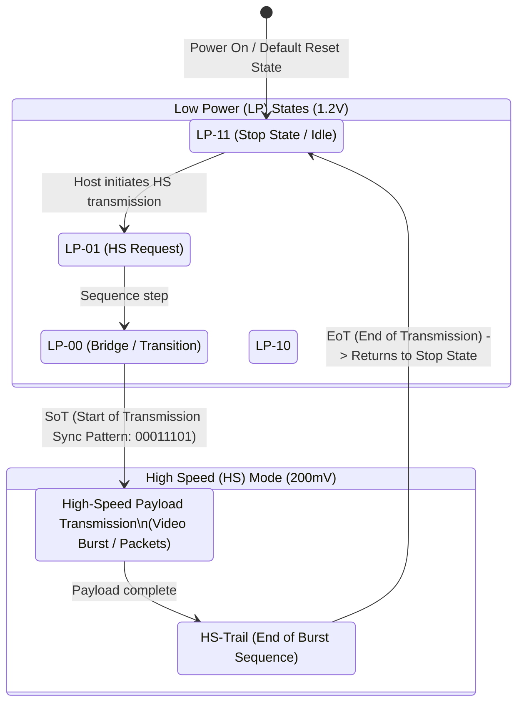

# MIPI DSI Protocol & PHY Integration

The Mobile Industry Processor Interface (MIPI) Display Serial Interface (DSI) is a ubiquitous high-speed serial interface between host SoCs and display panels or bridge ICs.

---

## 1. Physical Layer: D-PHY vs C-PHY

```text
D-PHY Architecture (Clock + Data):
SoC Host                                    Panel / Bridge
+----------+   Differential Clock Lane      +----------+
|          |===============================>|          |
|          |   Differential Data Lane 0     |          |
| MIPI DSI |<==============================>| MIPI DSI | (Bidirectional for BTA)
|   Host   |   Differential Data Lane 1     |  Device  |
|          |===============================>|          |
|          |   Differential Data Lane 2..3  |          |
|          |===============================>|          |
+----------+                                +----------+
```

| Parameter | D-PHY | C-PHY |
| :--- | :--- | :--- |
| **Wiring** | 1 Differential Clock Pair + 1 to 4 Differential Data Pairs | 1 to 3 "Trios" (3 conductors per trio: A, B, C) |
| **Clocking** | Explicit DDR Differential Clock Lane | Embedded Clock (Clock recovered from trio transitions) |
| **Signaling Levels** | **LP**: 0 to 1.2V CMOS; **HS**: 200mV Differential Swing | **HS**: 3-level signaling (-266mV, 0V, +266mV) |
| **Speed per Lane/Trio** | Up to 4.5 Gbps per lane (D-PHY v2.5) | Up to 3.5 Gsym/s (~8.0 Gbps per trio in C-PHY v2.0) |
| **Automotive Adoption** | High (Widely supported across all automotive SoCs) | Emerging in high-resolution multi-camera/display ADAS |

---

## 2. D-PHY Operating States & Protocol

D-PHY lanes toggle dynamically between **Low-Power (LP)** mode (control and register read/write) and **High-Speed (HS)** mode (pixel transmission):



### Bus Turnaround (BTA)
To read registers from a display (e.g., Read Panel ID `0xDA`), the host initiates a **Bus Turnaround (BTA)** sequence:
1. Host drives line state: `LP-11` $\rightarrow$ `LP-10` $\rightarrow$ `LP-00` $\rightarrow$ `LP-00` (High-Z).
2. Panel acknowledges: Drives `LP-00` $\rightarrow$ `LP-10` $\rightarrow$ `LP-11`.
3. Panel transmits data bytes in LP mode, then releases bus back to host.

---

## 3. Video Mode vs. Command Mode

### Video Mode (Stream-Driven Panels)
The host controller continuously transmits real-time video frames (analogous to RGB parallel scanout). The panel does not have internal frame memory.
* **Non-Burst Mode with Sync Pulses**: Accurately reproduces HSYNC and VSYNC timing pulses using explicit start/end sync packets. Highest timing accuracy.
* **Non-Burst Mode with Sync Events**: Sends single sync event packets; blanking is represented by generic blanking packets.
* **Burst Mode**: Compresses pixel packets into the fastest possible HS bursts, allowing the bus to drop into LP-11 for long intervals (saves power and reduces EMI).

### Command Mode (Smart Panels with GRAM)
The panel includes an integrated Graphic RAM (GRAM) frame buffer.
* Host sends pixel updates via DCS write commands (e.g., `0x2C` Memory Write) only when the UI changes.
* Panel refresh logic drives the display glass autonomously.
* Eliminates continuous high-speed memory fetch from SoC RAM when UI is static.

---

## 4. DSI Packet Structure & Standard DCS Commands

### Packet Formats
* **Short Packet (4 Bytes)**: Used for commands, parameterless controls, and register writes:
  `[Data ID: 1B] [Data 0: 1B] [Data 1: 1B] [ECC: 1B]`
* **Long Packet (6 to 65541 Bytes)**: Used for pixel bursts and multi-byte register configuration:
  `[Data ID: 1B] [Word Count: 2B] [ECC: 1B] [Payload Data: 0-65535B] [Checksum/CRC: 2B]`

### Essential Display Command Set (DCS) Commands

```c
/* Standard MIPI DCS Command Bytes */
#define MIPI_DCS_NOP                   0x00
#define MIPI_DCS_SOFT_RESET            0x01
#define MIPI_DCS_EXIT_SLEEP_MODE       0x11 /* Sleep Out: Requires 120ms delay before next command */
#define MIPI_DCS_ENTER_NORMAL_MODE     0x13
#define MIPI_DCS_SET_DISPLAY_OFF       0x28
#define MIPI_DCS_SET_DISPLAY_ON        0x29 /* Display On */
#define MIPI_DCS_SET_COLUMN_ADDRESS    0x2A
#define MIPI_DCS_SET_PAGE_ADDRESS      0x2B
#define MIPI_DCS_WRITE_MEMORY_START    0x2C
#define MIPI_DCS_SET_ADDRESS_MODE      0x36 /* MADCTL: Rotation & RGB/BGR order */
#define MIPI_DCS_SET_PIXEL_FORMAT      0x3A /* COLMOD: e.g., 0x77 for 24-bit RGB888 */
```

---

## 5. DSI Bring-Up Failure Modes & Debug Checklist

| Symptom / Register Flag | Root Cause | Remediation |
| :--- | :--- | :--- |
| **Lanes stuck in LP-11** | DSI Host PHY not enabled, or PLL failed to lock | Check DSI core clocks, regulator supply to D-PHY, and PHY reset assertion sequence. |
| **SoT Error (Start of Transmission)** | D-PHY timing mismatch between host and panel receiver | Adjust host `tHS-PREPARE` and `tHS-ZERO` parameters in DTS / driver to match panel RX spec. |
| **BTA Timeout on Read** | Panel not acknowledging turnaround or pull-up/pull-down floating | Check Data Lane 0 wiring continuity; verify panel is out of sleep (`0x11` sent) before reading. |
| **CRC / Checksum Errors** | Signal integrity degradation, excessive rise times, or wrong HS clock rate | Reduce trace length, enable transmitter pre-emphasis, verify $100\,\Omega$ differential termination. |
| **Display shows noise / color inversion** | Pixel format mismatch in DCS `0x3A` or RGB vs BGR bit order | Adjust DCS `0x3A` (`0x55`=16-bit, `0x77`=24-bit) and bit 3 of DCS `0x36` (RGB/BGR bit). |
