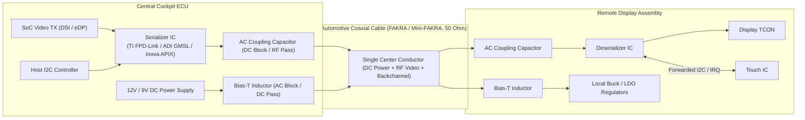
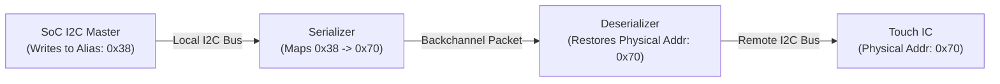

# Automotive Serializer / Deserializer (SerDes) Systems

Serializer/Deserializer (SerDes) chipsets bridge the gap between cockpit processing units (SoCs) and remote automotive displays across long automotive cable harnesses (5 to 15 meters).

---

## 1. SerDes Physical Architecture & Power-over-Coax (PoC)

Automotive SerDes technology multiplexes high-speed video, bidirectional control buses, and DC power onto a single coaxial or shielded twisted-pair (STP) cable:



---

## 2. Key Automotive SerDes Standards

| Parameter | TI FPD-Link III / IV | ADI GMSL 2 / 3 | Inova APIX 2 / 3 | MIPI A-PHY |
| :--- | :--- | :--- | :--- | :--- |
| **Max Forward Bandwidth** | Up to 13.5 Gbps (FPD-Link IV) | Up to 12 Gbps (GMSL 3) | Up to 12 Gbps (APIX 3) | Up to 16 Gbps (Gear 5) |
| **Backchannel Rate** | 10 to 50 Mbps | 187.5 Mbps | Up to 187.5 Mbps | Bidirectional up to 200 Mbps |
| **Transmission Medium** | Coax (50 $\Omega$) or STP (100 $\Omega$) | Coax (50 $\Omega$) or STP (100 $\Omega$) | STP or Quad-twist | Coax or STP |
| **Safety Features** | Link CRC, Video line CRC, BIST | Link CRC, Packet CRC, ECC | End-to-end CRC, Frame verify | ASIL-B to ASIL-D functional safety |

---

## 3. I2C Address Aliasing (Remote Bus Translation)

Because the remote display PCB contains I2C slave devices (Touch IC, Backlight LED driver, EEPROM) separated from the SoC by a high-speed serial link, SerDes chipsets implement **I2C Address Translation / Aliasing**:



### Why Address Aliasing is Critical:
1. **Address Collision Avoidance**: Multiple remote displays (e.g., Driver Cluster and Passenger Display) may use identical touch ICs configured to physical address `0x70`. Aliasing maps them to unique virtual addresses on the SoC bus (e.g., `0x38` for Cluster Touch, `0x39` for Passenger Touch).
2. **Transparent Access**: The Linux touch driver communicates directly with the alias address without knowing a SerDes link exists.

### Typical Alias Configuration Table (Serializer Registers)
```text
SlaveID[0]    = 0x70   (Physical address of remote touch IC)
SlaveAlias[0] = 0x38   (Virtual address visible to host SoC)
SlaveID[1]    = 0x50   (Physical address of remote EEPROM)
SlaveAlias[1] = 0x54   (Virtual address visible to host SoC)
```

---

## 4. GPIO & Interrupt (IRQ) Forwarding

SerDes chipsets provide bidirectional GPIO forwarding over the backchannel without CPU intervention:

* **Remote Interrupt to Host (Touch IRQ)**:
  1. Touch IC asserts its physical `INT` pin Low on the remote display PCB.
  2. Deserializer samples the pin and transmits an interrupt token via the backchannel.
  3. Serializer receives the token and asserts its physical `GPIO/INT` pin to trigger the SoC interrupt handler.
  * Typical propagation latency: **< 1 microsecond**.
* **Host Control to Remote Display (Backlight PWM / Enable)**:
  1. SoC outputs PWM signal to Serializer GPIO input.
  2. Serializer encodes PWM transitions into backchannel packets.
  3. Deserializer reconstructs the PWM waveform at its remote GPIO pin to drive the backlight LED driver.

---

## 5. SerDes Bring-Up & Link Diagnostics

### 1. The LOCK Pin: The First Sign of Life
* The hardware `LOCK` pin on the Deserializer indicates that the receiver clock-and-data recovery (CDR) PLL has locked onto the high-speed bitstream.
* **If LOCK is LOW**:
  * Check PoC voltage supply at both ends ($12\,\text{V} \pm 5\%$).
  * Verify Serializer reference clock and input video clock are active.
  * Inspect coax cable and FAKRA connector seating.
  * Check for short-to-ground or open-circuit on the coax line.

### 2. Built-In Self-Test (BIST) & Eye Margins
Before enabling complex OS display drivers, activate the SerDes internal BIST pattern:
* Serializer transmits a pseudo-random binary sequence (PRBS31).
* Deserializer verifies incoming bitstream and counts bit errors.
* Most automotive SerDes ICs provide an internal **Adaptive Equalizer (AEQ)** register readout showing cable attenuation margin (e.g., AEQ score from 0 to 15).
